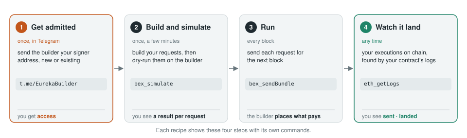

# bex-cookbook

**Run your code inside the block while it is built.**

BEX, Builder Execution Extensions, lets you put your own EVM program inside the Eureka builder. The builder runs it
on the live state of the block it is building, again after every bundle it places. When your program sees what it
waits for, it returns a plan, and the builder signs a transaction that runs the plan right there, in the same block.

This repo is a cookbook: each recipe is one use case, ready to clone and run.

> **Unaudited, experimental demos. Use at your own risk. Not financial advice, and no profit is guaranteed. You are responsible for following the laws that apply to you.**

## What BEX gives you

- **The state that matters.** Your code reads the block as it is built, not the last block and not the mempool.
  It sees each bundle's effect the moment the builder places it.
- **Free, large compute.** The compute runs off-chain in the builder's EVM. It costs no gas and is not bound by
  the block gas limit: up to 500M gas per call.
- **Act at the exact point.** The builder places your execute transaction right after the state you waited for.
  No mempool race and nothing exposed before the block.
- **Nothing lands unless it should.** If your program returns nothing, nothing happens on chain. The builder places
  the execute only when it pays its way.
- **No gas, no transaction of your own.** You send signed requests. The builder signs the execute, and the
  execute pays the builder.

<picture>
  <source media="(prefers-color-scheme: dark)" srcset="docs/bex-dark.svg">
  
</picture>

## What you can build

Anything that must act on the state inside a block, right after something happens in it:

- **Backruns.** Close a price gap the moment a swap opens it. [Ready: `backrun/`](backrun/).
- **Liquidations.** Repay a position in the same block as the price update that makes it unsafe.
- **Keepers.** Rebalance, settle or update only when the state calls for it, with the check done for free.
- **Order and intent fills.** Price a fill on the exact state it will execute on.
- **Games, auctions and claims.** Decide on the last state of the block, not a stale one.

Only `backrun/` is a recipe today. The others are open for anyone to build, and new recipes are welcome.

## Recipes

| Recipe | What it does |
|---|---|
| [`backrun/`](backrun/) | Backruns every block with no capital and no gas. It solves arbitrage cycles over Uniswap V2, V3 and V4 inside the block and sizes each trade to the exact optimum. |

Each recipe is self-contained. Open its README and run its commands from its directory.

## Get started

Every BEX app goes through the same four steps.

<picture>
  <source media="(prefers-color-scheme: dark)" srcset="docs/quickstart-dark.svg">
  
</picture>

To get admitted, post in [t.me/EurekaBuilder](https://t.me/EurekaBuilder) with your name, your signer address and
one line on what you will build. A signer is any Ethereum address. It signs your requests and never needs ETH.

The endpoint's limits need no signature:

```sh
curl -s https://rpc.eurekabuilder.xyz -H 'content-type: application/json' \
  -d '{"jsonrpc":"2.0","id":1,"method":"bex_capabilities","params":[]}'
```

```sh
git clone --recursive https://github.com/eureka-builder/bex-cookbook
```

## License

[BSD-3-Clause-Clear](LICENSE). It grants no patent rights. The files compiled into the deployed executor (`backrun/contracts/src/CycleExecutor.sol` and the files it imports) stay MIT, as their SPDX headers say, so they match the verified contract on mainnet.
