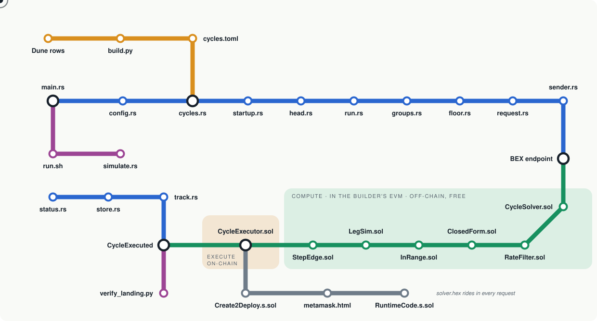

# Code tour

bex-backrun drawn as a transit network. Every station is a file. A new head leaves on the blue line, changes at the builder, gets solved and executed on the green line, and comes home as a landing. The dot on the map rides that route; the list below names each stop.

<picture>
  <source media="(prefers-color-scheme: dark)" srcset="tour-map-dark.svg">
  
</picture>

Rings are interchanges, where one part of the system hands over to another. The shaded zones show where the code runs.

| Line | | What runs on it |
|---|---|---|
| Mine line | Python | the cycle set |
| Bot line | Rust | heads to requests |
| Chain line | Solidity | solve and execute |
| Ops line | Shell and Python | run and check |
| Yard line | Forge scripts | build and deploy |

## Ride one block

From a new head to a landed profit, in the order the code runs. Most blocks the ride ends quietly at stop 9: no live direction, so no execute is placed.

1. **[head.rs](#head)**: Block N lands. The head stream yields it once, in order, and the clock for block N+1 starts.
2. **[run.rs](#run)**: The send loop wakes up: one request per group, all aimed at block N+1.
3. **[groups.rs](#groups)**: Cycles that share a pool ride together. One solveMany, one pending slot.
4. **[floor.rs](#floor)**: Each cycle's ticket price: enough profit for the builder's share to cover the gas at N+1's basefee.
5. **[request.rs](#request)**: The request is assembled: solver code and calldata to compute, the executor's selector to execute.
6. **[sender.rs](#sender)**: Signed over its exact bytes and posted to every endpoint. No URL ever reaches a log.
7. **[BEX endpoint](#builder)**: Change here for the Chain line. The builder runs the compute after each bundle it places, off-chain and free.
8. **[CycleSolver.sol](#solver)**: CycleSolver reads every pool once and starts looking for the best input.
9. **[RateFilter.sol](#rate)**: Is this cycle alive? rho above 1 in one direction says yes. Most blocks it says no, and the ride ends quietly here.
10. **[ClosedForm.sol](#closed)**: Alive. The closed form gives the optimal input in one loop and one square root.
11. **[InRange.sol](#inrange)**: Does that input stay inside every pool's tick range? Then one exact swap step per leg settles it.
12. **[LegSim.sol](#legsim)**: If a swap crosses ticks, LegSim replays the Uniswap loop, wei for wei, until the walk finds the best input.
13. **[StepEdge.sol](#edge)**: Is there an 8-decimal token in the middle? StepEdge nudges the input to the best tooth of the sawtooth.
14. **[CycleExecutor.sol](#exec)**: The plan pays more than its gas, so the builder signs execute(plan). Flash swap in, cycle around, repay, split the profit.
15. **[CycleExecuted](#event)**: CycleExecuted is emitted with your tag. The coinbase got its share, your payout address got the rest.
16. **[track.rs](#track)**: Back on the Bot line. The tracker reads the log, then checks it again 2 and 12 blocks later.
17. **[store.rs](#store)**: One row in the landing table, keyed by block hash, tx hash and cycle id.
18. **[status.rs](#status)**: landed_final goes up by one. End of the line. The next head is already on its way.

## Routes

Four ways through a review, depending on what you want to check.

- **Express**: The whole idea in four stops: what is sent, who runs it, how it is solved, how it pays. [request.rs](#request) → [BEX endpoint](#builder) → [CycleSolver.sol](#solver) → [CycleExecutor.sol](#exec)
- **The math line**: From a yes-or-no rate test to an exact optimum, including the sawtooth. [RateFilter.sol](#rate) → [ClosedForm.sol](#closed) → [InRange.sol](#inrange) → [LegSim.sol](#legsim) → [StepEdge.sol](#edge)
- **Safety inspection**: Where funds move, what is refused up front, where keys could leak, how the address is pinned. [CycleExecutor.sol](#exec) → [cycles.rs](#cycles) → [startup.rs](#startup) → [sender.rs](#sender) → [Create2Deploy.s.sol](#create2) → [verify_landing.py](#verify)
- **Data line**: How 30 days of mined arbitrage become the 688 cycles the bot sends, and how they are packed. [Dune rows](#dune) → [build.py](#build) → [cycles.toml](#toml) → [groups.rs](#groups)

## Things that surprise reviewers

- **One request, both directions.** At most one orientation of a cycle can be profitable at once, so the solver checks both and the request never has to choose. ([RateFilter.sol](#rate))
- **No capital, ever.** The first leg is a flash swap and the last leg repays it from inside the first leg's callback. The executor starts and ends every transaction empty. ([CycleExecutor.sol](#exec))
- **A comment can move a contract.** The compiler's metadata hash is part of the init code, so editing a comment changes the CREATE2 address. A test pins it so nobody is surprised. ([Create2Deploy.s.sol](#create2))
- **The solver must not peek.** No gas reads, no balances, no code reads. Reads of pool storage and pool immutables only let the builder cache the result while the pools stay still. ([CycleSolver.sol](#solver))
- **Requests replace themselves.** uuid5(signer, name) plus a sequence number equal to the target block means each block's request replaces the previous one. ([request.rs](#request))
- **The algorithm rides along.** In code mode the solver's runtime code travels inside every request. Nothing needs deploying for the compute, only the executor. ([RuntimeCode.s.sol](#runtime))

## Stations

### Mine line: the cycle set

<a id="dune"></a>

#### Dune rows

[`cycles/mined/eth-anchor-30d.json`](../cycles/mined/eth-anchor-30d.json)

Thirty days of mined Ethereum arbitrage from a Dune query: closed Uniswap cycles that start and end on ETH, with every leg's pool, fee and tick spacing. The raw ore for the cycle set.

| Key part | What it does |
|---|---|
| `rows` | one entry per mined cycle path: every leg's pool, fee and tick spacing, with arb counts and USD profit |
| `sql` | the exact Dune query, so the rows can be reproduced |
| `query_id` | Dune query 9016757 |

**Look for:** The SQL travels with the rows, so anyone can rerun the query and get the same data.  
**Fun fact:** ETH and WETH count as one asset everywhere, so a cycle can start on V4 native ETH and close on V2 WETH.  
**Connects:** [build.py](#build)

<details><summary>From the file (rows elided)</summary>

```json
{ "query_id": 9016757,
  "execution_id": "01M5X11R90CGE2HZVK85PHRXCW",
  "sql": "-- ETH-anchored closed Uniswap cycles (V2/V3/hookless V4, 2-5 legs, distinct pools) ...",
  "rows": [ ... ] }
```

</details>

<a id="build"></a>

#### build.py

[`cycles/build.py`](../cycles/build.py)

Turns the mined rows into cycles.toml. It checks every pool against its factory's CREATE2 address or its V4 PoolKey id, ranks the cycles and drops the ones through tokens that break an execute.

| Key part | What it does |
|---|---|
| `legs_of(row)` | turns a mined row into legs and checks each pool against its CREATE2 address (V2/V3) or hookless PoolKey id (V4); returns the reason when one does not match |
| `apply_pins() / one_per_pool_set()` | puts the live order first, then keeps one orientation per pool set |

**Look for:** `EXCLUDED_TOKENS` near the top: tokens that tax transfers, rebase or auto-sell. There is no list of expensive cycles: the solver bounds its own cost.  
**Fun fact:** It carries a pure-Python Keccak so the build stays stdlib-only. With OpenSSL 3.2 or later it uses the fast one instead: 14.6 s became 0.3 s, same bytes.  
**Tested by:** `cycles/test_build.py`; python3 cycles/build.py rebuilds cycles.toml with no diff  
**Connects:** [Dune rows](#dune), [cycles.toml](#toml)

<details><summary>From the file</summary>

```python
def one_per_pool_set(out):
    """The first cycle of each pool set, in file order. A cycle and its reverse use the same pools, and the
    solver tries both orientations of every request, so a later cycle on the same pools adds only compute."""
    seen, kept = set(), []
    for c in out:
        pools = frozenset(pool_id(l) for l in c[-1])
        if pools not in seen:
            seen.add(pools)
            kept.append(c)
    return kept
```

</details>

<a id="toml"></a>

#### cycles.toml

[`cycles/cycles.toml`](../cycles/cycles.toml)

The timetable. 688 cycles, each a name and a list of legs. The bot sends them in file order, so the order is the strategy.

| Key part | What it does |
|---|---|
| `name` | token symbols, then version_fee per leg |
| `legs` | version, token_in, token_out, fee (hundredths of a bip) and tick_spacing per leg |

**Look for:** The header comment: it says exactly what was kept, what was dropped and why, by count.  
**Fun fact:** Cycle names read like route codes: eth_usdc_usdt__v3_100_v4_7_v3_100 is WETH to USDC on V3 at 1 bp, USDC to USDT on V4 at 0.07 bp, back to WETH on V3.  
**Tested by:** EndToEnd.t.sol test_quietMarket_everyMinedCycle: every mined cycle on a fork, from the generated fixture  
**Connects:** [build.py](#build), [cycles.rs](#cycles)

<details><summary>From the file</summary>

```toml
# 196 arbs, $783 / 30d (robust $75), pure-WETH
[[cycles]]
name = "eth_usdc_usdt__v3_100_v4_7_v3_100"
legs = [
  { version = 3, token_in = "0xC02aaA39b223FE8D0A0e5C4F27eAD9083C756Cc2", token_out = "0xA0b86991c6218b36c1d19D4a2e9Eb0cE3606eB48", fee = 100, tick_spacing = 1 },
  { version = 4, token_in = "0xA0b86991c6218b36c1d19D4a2e9Eb0cE3606eB48", token_out = "0xdAC17F958D2ee523a2206206994597C13D831ec7", fee = 7, tick_spacing = 1 },
  { version = 3, token_in = "0xdAC17F958D2ee523a2206206994597C13D831ec7", token_out = "0xC02aaA39b223FE8D0A0e5C4F27eAD9083C756Cc2", fee = 100, tick_spacing = 1 },
]
```

</details>

### Bot line: heads to requests

<a id="cycles"></a>

#### cycles.rs

[`bot/src/cycles.rs`](../bot/src/cycles.rs) · interchange

Loads cycles.toml and refuses any cycle the contracts would refuse, so a bad file fails once at startup instead of on every block.

| Key part | What it does |
|---|---|
| `Leg / Cycle` | the cycles.toml shapes |
| `load_cycles` | reads the file and refuses duplicate names |
| `validate` | the same rules as Pools.validate on chain: 2+ legs, versions 2-4, V2 fee 3000, ETH vs WETH per version, each leg's token_out is the next token_in, starts on ETH, no pool twice |

**Look for:** The checks mirror Pools.validate in Solidity, rule for rule.  
**Fun fact:** V2 and V3 legs must say WETH and V4 legs must say address(0) for ETH. Mixing them up is the most common hand-written mistake, so it gets its own error.  
**Tested by:** 5 unit tests in cycles.rs; Pools.t.sol for the Solidity twin  
**Connects:** [cycles.toml](#toml), [config.rs](#config), [startup.rs](#startup)

<details><summary>From the file</summary>

```rust
bail!("needs at least 2 legs, has {}", c.legs.len());
// ...
bail!("leg {i}: version {} not in {{2,3,4}}", l.version);
bail!("leg {i}: fee {} does not fit uint24", l.fee);
bail!("leg {i}: V2 leg needs fee 3000 and tick_spacing 0");
bail!("leg {i}: V2/V3 leg must use WETH, not address(0)");
bail!("leg {i}: V4 leg must use address(0) for ETH, not WETH");
```

</details>

<a id="main"></a>

#### main.rs

[`bot/src/main.rs`](../bot/src/main.rs) · interchange

The command line: run, simulate and status. Its module comment lists the library modules in the order a request flows through them, which makes it the best first file to open.

| Key part | What it does |
|---|---|
| `cmd_run` | loads config and cycles, runs the startup checks, then the send loop and the tracker side by side |
| `cmd_simulate` | the same request per cycle as a dry run with bex_simulate |
| `cmd_status` | the sends and landings in a window of blocks; --probe solves every cycle on your node instead |

**Look for:** How each command wires config, cycles, startup checks and the head stream together.  
**Fun fact:** The tracker runs next to the send loop. If it dies, the bot logs it and keeps sending.  
**Tested by:** `bot/tests/run.rs`; bot/scripts/devnet-smoke.sh: a canonical landing on a devnet  
**Connects:** [config.rs](#config), [run.sh](#runsh)

<details><summary>From the file</summary>

```rust
//! The `bex-backrun` command line: `run`, `simulate` and `status`.
//!
//! The library modules, in the order of the request flow:
//! `config` (bot.toml) and `cycles` (cycles.toml) are loaded, `startup` checks the builder and the
//! contracts, `head` yields new heads, `groups` puts cycles into requests, `floor` prices each
//! cycle's gas, `request` builds each request, `sender` posts it, `store` records it, and `track`
//! reads what happened. `simulate` and `status` are the other two commands.
```

</details>

<a id="config"></a>

#### config.rs

[`bot/src/config.rs`](../bot/src/config.rs)

Reads bot.toml, resolves relative paths, loads the solver code file, and refuses settings that cannot work. Every command starts here.

| Key part | What it does |
|---|---|
| `BotConfig / load_bot` | every setting with its default; relative paths resolve against the file's directory |
| `MAX_CODE_BYTES = 24,576` | EIP-170, also the builder's cap for compute code |
| `Select` | top sends the first groups that fit the pending budget; all refuses to start if they do not fit |
| `UuidMode` | cycle (one live request per group) or parity (alternating ids, half the budget) |

**Look for:** bot/bot.example.toml next to it: every setting has a comment written for an operator.  
**Fun fact:** A signer_key field in the file is an error. The key only ever comes from an environment variable.  
**Tested by:** 13 unit tests in config.rs  
**Connects:** [main.rs](#main), [cycles.rs](#cycles)

<details><summary>From bot/bot.example.toml</summary>

```rust
# Share of the profit that goes to block.coinbase, in bps (1..=10000). The rest goes to
# payout_address. The builder signs the execute only when the coinbase gains more than the gas,
# whatever the share.
builder_share_bps = 5000
# Who gets the rest (Plan.recipient). Default: the signer address. An address that cannot take
# ETH (a contract without receive) makes every execute revert.
# payout_address = "0x..."
# The bot sends min_profit_wei and weiPerGas = ceil(next basefee * gas_margin * 10000 / builder_share_bps).
# The solver prices the plan's gas: the profit floor is max(min_profit_wei, weiPerGas * gas(plan), 1).
min_profit_wei = "0"
gas_margin = 1.0
```

</details>

<a id="startup"></a>

#### startup.rs

[`bot/src/startup.rs`](../bot/src/startup.rs)

The checks before the first request. Each one stops the bot with a message that says what to fix: the endpoint must accept code of this size, the solver and executor must agree on the venues, and the executor must exist.

| Key part | What it does |
|---|---|
| `check` | runs the checks below for every endpoint before the first request |
| `check_compute_code` | asks bex_capabilities whether the endpoint takes compute code of this size |
| `check_venues` | reads venues() from solver and executor: same factories, same WETH as bot.toml, and code at the executor |

**Look for:** Every error names the file or setting to change. None just says 'failed'.  
**Fun fact:** Until the shared executor is deployed, this is exactly where simulate and run stop.  
**Tested by:** bot/tests/simulate.rs: check and check_compute_code against a mock builder and node  
**Connects:** [cycles.rs](#cycles), [head.rs](#head)

<details><summary>From the file</summary>

```rust
if v.as_str() == Some("0x") {
    bail!("{name} {addr}: no contract at this address (venues() returned no data); is it deployed? See contracts/README.md");
}
```

</details>

<a id="head"></a>

#### head.rs

[`bot/src/head.rs`](../bot/src/head.rs)

The heartbeat. A stream of new block heads from WebSocket newHeads, with HTTP polling filling in while the socket connects, drops or goes quiet. Each head starts one batch of sends.

| Key part | What it does |
|---|---|
| `Head` | number, basefee, gas used, gas limit, timestamp: what the floor needs |
| `ws_heads` | WS newHeads with HTTP polling filling in; after 25 s of silence polling serves alone for 30 s, then the WS is tried again |
| `poll_heads` | eth_getBlockByNumber(latest) every 500 ms |
| `monotonic` | drops any head not above the last one |

**Look for:** monotonic(): a head that is not newer than the last one is dropped.  
**Fun fact:** A same-height reorg head is dropped on purpose. The bot targets number + 1 either way.  
**Tested by:** bot/tests/head.rs: WS and polling against mock servers; `bot/tests/head_log.rs`  
**Connects:** [startup.rs](#startup), [run.rs](#run)

<details><summary>From the file</summary>

```rust
/// Drops heads whose number is not above the last yielded one. A same-height
/// reorg head is dropped by design: the bot targets `number + 1` either way.
pub fn monotonic(s: impl Stream<Item = Head>) -> impl Stream<Item = Head> {
    let mut last: Option<u64> = None;
    s.filter_map(move |h| {
        let keep = last.is_none_or(|l| h.number > l);
        if keep {
            last = Some(h.number);
        }
        futures::future::ready(keep.then_some(h))
    })
}
```

</details>

<a id="run"></a>

#### run.rs

[`bot/src/run.rs`](../bot/src/run.rs)

The send loop. For each head N, every group gets a request for block N+1 with a fresh weiPerGas. After a short delay every request goes to every endpoint, and each send ends as one row in the store.

| Key part | What it does |
|---|---|
| `select_groups` | fixes the groups once at startup, so live requests are never replaced by a changed set |
| `run_until` | one batch per head; a newer head supersedes batches that have not started |
| `send_with_retry` | one retry after 200 ms for a timeout or transport error, never for an RPC error |
| `POSTS_PER_ENDPOINT = 16` | the most requests in flight per endpoint |

**Look for:** superseded: a newer head stops the sends of older batches that have not started yet.  
**Fun fact:** The first answer that says the signer is not admitted stops the whole run. No point shouting at a door that is locked.  
**Tested by:** `test_newer_head_supersedes_inflight_batch`; `test_timeout_retried_once_with_same_body`; `test_run_stops_on_unadmitted_signer`  
**Connects:** [head.rs](#head), [groups.rs](#groups)

<details><summary>From the file</summary>

```rust
//! 1. every group gets a `bex_sendBundle` body for target block N+1, with each cycle's profit
//!    floor at the basefee of N+1 (`floor.rs`, `request.rs`);
//! 2. after `send_delay_ms`, every body goes to every endpoint (`sender.rs`), at most
//!    [`POSTS_PER_ENDPOINT`] at a time per endpoint, with one retry of a timeout or transport error;
//! 3. each send ends with one [`Record`] in the store (`store.rs`).

/// Most POSTs in flight per endpoint, across batches.
pub const POSTS_PER_ENDPOINT: usize = 16;
```

</details>

<a id="groups"></a>

#### groups.rs

[`bot/src/groups.rs`](../bot/src/groups.rs)

Packs cycles into requests. A group is a seed cycle plus the later cycles that share a pool with it. They compete for the same price move, so one request with solveMany covers all of them and uses one pending slot.

| Key part | What it does |
|---|---|
| `shares_pool` | two cycles touch the same pool |
| `group_cycles` | greedy: each seed collects later cycles that share a pool with it, up to group_size |
| `Group::copy` | request_copies: copy k is named name#k and gets its own uuid and code target |

**Look for:** The greedy grouping in group_cycles and its tests with group_size 1 and 4.  
**Fun fact:** The builder can execute at most one of a group's cycles on a given price move, so separate requests would only waste slots.  
**Tested by:** 4 unit tests in groups.rs, including group size 1 and 4  
**Connects:** [run.rs](#run), [floor.rs](#floor)

<details><summary>From the file</summary>

```rust
//! Groups of cycles: one request (`solveMany`) per group. The builder runs the group's best plan.
//!
//! A group is a seed cycle and the later cycles that share a pool with the seed, up to
//! `group_size`. Cycles that share a pool compete for the same price move, and the builder
//! executes at most the best of them on it.
```

</details>

<a id="floor"></a>

#### floor.rs

[`bot/src/floor.rs`](../bot/src/floor.rs)

The ticket price. The wei of profit the builder needs per unit of execute gas, at the next block's basefee. The bot sends it as weiPerGas; the solver prices the plan's gas (its model includes the builder's 21,000-gas operator refill) and returns NoProfit below weiPerGas × gas. Nothing is placed then.

| Key part | What it does |
|---|---|
| `next_base_fee` | the next block's basefee, alloy's EIP-1559 formula |
| `wei_per_gas` | ceil(basefee × margin / share): wei of profit per unit of execute gas |

**Look for:** The margin becomes basis points once, so the floor has no float drift.  
**Fun fact:** The basefee formula is alloy's own, guarded for a zero gas limit, where alloy would divide by zero.  
**Tested by:** 4 unit tests in floor.rs: EIP-1559 vectors, the 1 wei minimum increase, weiPerGas share, margin and rounding  
**Connects:** [groups.rs](#groups), [request.rs](#request)

<details><summary>From the file</summary>

```rust
pub fn wei_per_gas(cfg: &BotConfig, next_base_fee: u128) -> U256 {
    let margin_bps = (cfg.gas_margin * 10_000.0).round() as u64;
    let num = U256::from(next_base_fee) * U256::from(margin_bps);
    num.div_ceil(U256::from(cfg.builder_share_bps))
}
```

</details>

<a id="request"></a>

#### request.rs

[`bot/src/request.rs`](../bot/src/request.rs)

Builds the BEX request: a compute step (the solver and its calldata, plus the solver's code in code mode) and an execute step (the executor and its selector). The builder appends the compute's return data to the selector, and that is the execute call.

| Key part | What it does |
|---|---|
| `BexRequest / Compute / Execute` | the JSON body, field for field |
| `solve_calldata / solve_many_calldata` | one cycle or a group of up to 8 |
| `code_target` | code mode: a fresh compute address per signer, cycle and block. The builder drops a code request whose target has code, a nonce or a balance, so a fixed address could be blocked by anyone sending it 1 wei |
| `tag(signer)` | bytes32 of the signer address, copied into the plan and the event |

**Look for:** appendComputeResult: solve returns abi.encode(Plan), so selector plus return data is exactly execute(plan).  
**Fun fact:** Each request's replacement id is uuid5(signer, name), and its sequence number is the target block, so each block's request replaces the last one instead of piling up.  
**Tested by:** `test_request_json_shape`; `test_signature_matches_reference_vector`; `test_code_target_matches_solidity_abi_encode`  
**Connects:** [floor.rs](#floor), [sender.rs](#sender)

<details><summary>From the file</summary>

```rust
//! { "targetBlock": N + 1,
//!   "replacementUuid": uuid5(signer, request name), "replacementSeqNumber": N + 1,
//!   "bex": {
//!     "compute": { "to": solver or code target, "calldata": solve(..) or solveMany(..),
//!                  "code": solver runtime code (code mode only) },
//!     "execute": { "to": executor, "selector": execute(Plan), "prefixArgs": "0x",
//!                  "appendComputeResult": true } } }
```

</details>

<a id="sender"></a>

#### sender.rs

[`bot/src/sender.rs`](../bot/src/sender.rs)

Every network call goes through here: signed POSTs to builder endpoints (an X-Flashbots-Signature over the exact bytes) and plain JSON-RPC to the node.

| Key part | What it does |
|---|---|
| `envelope` | the exact bytes that are signed and posted |
| `call / send_bundle` | signed POSTs with X-Flashbots-Signature (EIP-191 over the body hash) |
| `rpc` | plain JSON-RPC to the node |
| `not_admitted` | recognises the builder's -32001 'access rejected' answer, which stops the run |
| `redact / host_port` | every error keeps host:port only |

**Look for:** redact(): no error or log line ever holds a full URL, because RPC URLs often carry keys.  
**Fun fact:** envelope() builds the exact bytes that get signed and posted, so the signature can never cover a different serialisation of the body.  
**Tested by:** `test_transport_error_recorded_whole_without_url`; `test_run_stops_on_unadmitted_signer`  
**Connects:** [request.rs](#request), [BEX endpoint](#builder)

<details><summary>From the file</summary>

```rust
/// `msg` with `url` replaced by its `host:port`. An alloy or reqwest error's Display
/// appends ` for url (<full URL>)`, and the URL can hold a key.
pub fn redact(msg: impl std::fmt::Display, url: &Url) -> String {
    msg.to_string().replace(url.as_str(), &host_port(url))
}
```

</details>

<a id="track"></a>

#### track.rs

[`bot/src/track.rs`](../bot/src/track.rs)

Reads the executor's logs with your tag, from a block cursor up to each head, and checks every landing's block hash again 2 and 12 blocks later.

| Key part | What it does |
|---|---|
| `track_head` | one tick per head: scan new logs, then confirm older landings |
| `scan_logs` | eth_getLogs for the executor and your tag, at most 100 blocks per call; the newest blocks are re-scanned every head |
| `confirm_landings` | re-checks block hashes at depth 2 and 12 and unwinds a reorged landing |

**Look for:** A reorged landing rewinds the cursor, so the replacement block's logs get read.  
**Fun fact:** A landing only counts as final after its second check, 12 blocks deep.  
**Tested by:** `test_landing_reorged_after_depth_2_is_unwound_at_depth_12`; `test_landing_with_another_tag_is_ignored`; `test_landing_cursor_advances_only_on_success_and_fills_gaps`  
**Connects:** [CycleExecuted](#event), [store.rs](#store)

<details><summary>From the file</summary>

```rust
/// A landing's block hash is checked at this depth (provisional) ...
const CONFIRM_DEPTH: u64 = 2;
/// ... and again at this one (final). A landing counts as final only after this check.
pub const CONFIRM_DEPTH_FINAL: u64 = 12;
```

</details>

<a id="store"></a>

#### store.rs

[`bot/src/store.rs`](../bot/src/store.rs)

The logbook. One SQLite file with three tables: every send, every landing, and the scan cursor.

| Key part | What it does |
|---|---|
| `Record` | one send: block, cycle, endpoint, bundle hash or error, retries |
| `Store` | the trait run writes through |
| `SqliteStore` | one writer thread owns the connection; jobs arrive over a channel |
| `MemStore` | the in-memory store for tests |

**Look for:** One writer thread owns the only connection, and every operation is a closure sent over a channel, so SQLite never blocks the async runtime.  
**Fun fact:** Tests swap it for MemStore, an in-memory store with the same trait.  
**Tested by:** exercised by bot/tests/run.rs and bot/tests/track.rs  
**Connects:** [track.rs](#track), [status.rs](#status)

<details><summary>From the file</summary>

```rust
CREATE TABLE IF NOT EXISTS sent(
    block INTEGER NOT NULL, cycle TEXT NOT NULL, endpoint TEXT NOT NULL,
    bundle_hash TEXT, error TEXT, sent_at INTEGER NOT NULL, retries INTEGER NOT NULL DEFAULT 0);
CREATE TABLE IF NOT EXISTS landing(
    block INTEGER NOT NULL, block_hash TEXT NOT NULL, tx_hash TEXT NOT NULL,
    cycle_id TEXT NOT NULL, amount_in TEXT NOT NULL, profit TEXT NOT NULL,
    paid TEXT NOT NULL, canonical INTEGER, confirmed_depth INTEGER,
    UNIQUE(block_hash, tx_hash, cycle_id));
CREATE TABLE IF NOT EXISTS meta(key TEXT PRIMARY KEY, value INTEGER NOT NULL);
```

</details>

<a id="status"></a>

#### status.rs

[`bot/src/status.rs`](../bot/src/status.rs)

The scoreboard. One row per cycle and per request name: how many requests the builder took, and how many landed, final or provisional.

| Key part | What it does |
|---|---|
| `status / format_table` | the per-name table of sent, landed_final and landed_provisional |
| `revert_of` | names NoProfit, TooManyCrossings and BadLeg from their selectors |
| `solve_latest / probe` | eth_call of solve at latest; in code mode a state override installs the solver code |

**Look for:** --probe runs the solver at latest on your own node, with no builder and no signer.  
**Fun fact:** It also names the custom errors (NoProfit, TooManyCrossings, BadLeg) from selectors that come straight from the Solidity declarations.  
**Tested by:** unit test in status.rs; `bot/tests/simulate.rs`  
**Connects:** [store.rs](#store)

<details><summary>From the file</summary>

```rust
/// `landed_final` counts canonical `CycleExecuted` logs re-checked at depth 12,
/// `landed_provisional` those canonical at depth 2 only.
pub const COLUMNS: [&str; 3] = ["sent", "landed_final", "landed_provisional"];
```

</details>

### Chain line: solve and execute

<a id="builder"></a>

#### BEX endpoint

*the builder · not in this repo* · interchange

The interchange. The builder runs your compute inside its own EVM, on the block it is building, after each bundle it places. That run is off-chain and free. If the result is a plan that pays more than its gas, the builder signs execute(plan) with its own key and places it in the block.

| Key part | What it does |
|---|---|
| `bex_sendBundle` | the request: compute, then execute if it pays |
| `bex_simulate` | the same request as a dry run, with compute and execute gas and the revert data |
| `bex_capabilities` | what the endpoint accepts, such as the compute code size |

**Look for:** This station is not in the repo. Its contract with the bot is the request in request.rs and the answers handled in sender.rs and simulate.rs.  
**Fun fact:** The compute can use up to 500M gas, far more than any block allows, because it never lands on chain. Only the small execute does.  
**Tested by:** mocked with wiremock in bot/tests  
**Connects:** [sender.rs](#sender), [CycleSolver.sol](#solver)

<details><summary>A sketch of the interface, not code from this repo</summary>

```text
bex_sendBundle {
  compute:  run the solver on the block so far     (off-chain, free)
  execute:  if the plan pays more than its gas,
            sign execute(plan) and place it          (on-chain, cheap)
}

The signer needs no ETH. The builder pays the execute's gas
and takes its share of the profit in the same transaction.
```

</details>

<a id="solver"></a>

#### CycleSolver.sol

[`contracts/src/CycleSolver.sol`](../contracts/src/CycleSolver.sol)

Finds the input that maximises a cycle's net profit (the profit less its floor: the larger of minProfitWei and weiPerGas times the modelled execute gas), from pool storage and pool immutables alone. It reads every pool once, rules out dead cycles, tries the closed form, checks it exactly, and walks tick region by tick region only when a swap crosses a tick.

| Key part | What it does |
|---|---|
| `solve` | one cycle: the seven steps, returns a Plan or reverts NoProfit |
| `solveMany` | up to 8 cycles in one compute; returns the plan with the largest margin over its own floor |
| `_walk` | the region walk when a swap crosses ticks: from input 0, one region between initialized ticks at a time, the closed form exact inside each, at most MAX_REGIONS = 32 regions; the candidate with the largest margin over its own floor wins |
| `_gas` | the execute gas model: G0 + a base per leg + G_STEP per swap step + G_CROSS per crossing, fitted in GasModel.t.sol |
| `_solveOne` | the plan's minProfit: the larger of minProfitWei and weiPerGas times the plan's gas, never 0, so execute always demands a profit |

**Look for:** The seven numbered steps in the contract comment. They are the whole algorithm in one screen.  
**Fun fact:** It never reads gas, balances or code. That purity lets the builder cache its answer while the pools it read stay unchanged, and SolverPurity.t.sol checks it.  
**Tested by:** `CycleSolver.t.sol`; `GasModel.t.sol`: the gas model against measured executes; SolverPurity.t.sol: no gas, balance or code reads; `EndToEnd.t.sol`  
**Connects:** [BEX endpoint](#builder), [RateFilter.sol](#rate)

<details><summary>From the file</summary>

```solidity
///   1. Marginal-rate product rho > 1 in neither orientation (or a dead pool: rho = 0): NoProfit. A CL pool
///      with no active liquidity is not dead: its spot rate bounds rho, and the walk moves through its gap.
///   2. Only the reverse is live: solve the reversed legs and return them in the plan (the executor
///      runs Plan.legs), so a request covers both orientations of its pool set. The reversed legs are
///      quoted again (warm reads).
///   3. The closed form on the in-range virtual reserves gives x0 (ClosedForm). x0 = 0 (a leg with no active
///      liquidity, or a negligible arb): the walk.
///   4. x0 stays inside every leg's active range: its exact output (one swap step per leg, the pool's
///      own arithmetic, InRange) is the plan, with no LegSim pass. Its gas is the same at every input
///      in range, and the in-range profit bounds every input, so a plan below the floor means NoProfit.
///   5. Otherwise the region walk (_walk): from input 0, region by region between initialized ticks,
///      the closed form on the end state is exact inside a region. The candidate with the largest margin
///      over its own floor (step 7), checked with one exact LegSim swap, is the plan.
///   6. An in-range plan that clears the caller's floor moves to the best nearby step edge when an
///      intermediate token is coarse (StepEdge: one unit worth >= 2^32 wei, e.g. 8-decimal BTC), never to a
///      lower profit, and only to an edge where the whole cycle stays in range. A walk plan is not refined.
///   7. The plan's floor is the larger of minProfitWei and weiPerGas times the plan's modelled gas, at
///      least 1. A profit below it: NoProfit. A weiPerGas or minProfitWei of 2^128 or more: NoProfit.
```

</details>

<a id="rate"></a>

#### RateFilter.sol

[`contracts/src/lib/RateFilter.sol`](../contracts/src/lib/RateFilter.sol)

The first filter. It multiplies each leg's spot price and fee into one number, rho. If rho is above 1 there is an arbitrage in that direction; if not in either direction, the solve stops right here.

| Key part | What it does |
|---|---|
| `Quote / quotes()` | every pool read once (slot0, liquidity or reserves) and reused by every later step |
| `rho / rhoReversed / direction` | which orientation is live, if any |
| `virtualReserves` | a CL pool in range as an equivalent constant-product pool, for the closed form |
| `v4Fee` | a V4 pool's swap fee: LP fee plus the protocol fee for that direction |

**Look for:** Fixed point Q128 throughout, and a cap on rho so a broken pool cannot overflow the product.  
**Fun fact:** Reversing a cycle inverts every price, so rho forward times rho reverse is below 1. At most one direction can ever be live, which is why one request covers both for free.  
**Tested by:** CycleSolver.t.sol: dead orientations and reversed plans  
**Connects:** [CycleSolver.sol](#solver), [ClosedForm.sol](#closed)

<details><summary>From the file</summary>

```solidity
/// rho = prod_i gamma_i * p_i, with p_i the spot out-per-in of leg i and gamma_i = 1 - fee_i. An
/// arb exists in this orientation iff rho > 1: profit'(0) = rho - 1 and profit is concave in the
/// input. Reversing a cycle inverts every spot price and takes each pool's fee for the other
/// direction (gamma'_i; differs from gamma_i only for a V4 protocol fee), so
/// rho_fwd * rho_rev = prod_i gamma_i * gamma'_i < 1: at most ONE orientation of any cycle is live.
/// One request therefore covers both directions at zero extra storage reads.
```

</details>

<a id="closed"></a>

#### ClosedForm.sol

[`contracts/src/lib/ClosedForm.sol`](../contracts/src/lib/ClosedForm.sol)

The optimal input in closed form. A chain of constant-product pools is again a curve a·x / (b + c·x), so the best input has a formula, and the formula's profit is an upper bound on the real one.

| Key part | What it does |
|---|---|
| `optimalInput` | x* and the maximum profit, rounded so the profit is an upper bound |
| `fold / inverse` | the curve of the first legs, and the input that makes it output a given amount: the walk maps a pool's distance to its next tick back to cycle input |
| `sqrt` | integer square root |
| `_shift / _shrUp` | keep the coefficients in 256 bits, rounding in the safe direction |

**Look for:** The rounding directions: a rounds up, b and c round down, so the bound can only overestimate.  
**Fun fact:** The whole optimiser for an n-leg cycle is one loop and one square root.  
**Tested by:** `ClosedForm.t.sol`  
**Connects:** [RateFilter.sol](#rate), [InRange.sol](#inrange)

<details><summary>From the file</summary>

```solidity
/// One pool with fee factor γ (gammaE6 / 1e6) gives out(x) = γ·Rout·x / (Rin + γ·x).
/// A chain of such pools is again out(x) = a·x / (b + c·x). Keeping γ in 1e6 units,
/// folding in the next pool (Rin, Rout, g) gives
///     a' = g·Rout·a,   b' = 1e6·Rin·b,   c' = 1e6·Rin·c + g·a,
/// starting from the identity (a, b, c) = (1, 1, 0). Profit out(x) − x peaks where
/// b + c·x = sqrt(a·b), so x* = (sqrt(a·b) − b) / c, and there is an arb only if a > b.
```

</details>

<a id="inrange"></a>

#### InRange.sol

[`contracts/src/lib/InRange.sol`](../contracts/src/lib/InRange.sol)

The fast lane. If the closed-form input keeps every pool inside its active tick range, the exact output is one swap step per leg, the pool's own arithmetic. No simulation needed.

| Key part | What it does |
|---|---|
| `limits` | the next initialised tick of each CL leg, from one bitmap word |
| `stepOut` | one leg's exact output, or 'would cross' |
| `cycleOut` | the whole cycle, if every leg stays in range |
| `inputTo` | the least leg input that moves a pool's price to a target, for the walk's region ends |

**Look for:** It is v4-core's SwapMath.computeSwapStep, the same function the pools run.  
**Fun fact:** An input of zero would be read as an exact-output swap by computeSwapStep, so it gets its own one-line guard.  
**Tested by:** CycleSolver.t.sol test_maxProfit_boundsRealisedBest_v3InRange / v4InRange; TickWord.t.sol: bitmap word boundaries  
**Connects:** [ClosedForm.sol](#closed), [LegSim.sol](#legsim)

<details><summary>From the file</summary>

```solidity
if (q.v2) return (V2Reader.amountOut(amountIn, q.rin, q.rout), true); // a V2 leg never crosses
if (amountIn == 0) return (0, true); // computeSwapStep reads 0 as exact output
uint160 next;
(next,, out,) = SwapMath.computeSwapStep(q.sqrtPriceX96, limit, q.liquidity, -int256(amountIn), q.fee);
if (next == limit) return (0, false); // reaches the tick: the pool would cross
inRange = true;
```

</details>

<a id="legsim"></a>

#### LegSim.sol

[`contracts/src/lib/LegSim.sol`](../contracts/src/lib/LegSim.sol)

The slow but exact lane. When a swap would cross ticks, LegSim runs the Uniswap swap loop itself, tick by tick, wei for wei, on current storage. The solver's walk grows one swap in pieces with it, then checks its answer with one exact swap.

| Key part | What it does |
|---|---|
| `tryCycleOut` | a probe that never reverts: infeasible when a leg crosses more than 32 ticks or takes more than 128 steps, or the cycle exceeds CYCLE_BUDGET |
| `Walk / startWalk / advance` | one cycle swap grown in pieces: each advance resumes every leg from its end state, for the walk's next region |
| `nextBoundary` | the next swap-loop boundary of a pool (initialized tick or bitmap word end), for the walk's region scan |
| `CYCLE_BUDGET = 180` | one unit per loop step plus W_CROSS = 7 per initialised tick crossed, summed over the legs |

**Look for:** The bounds: at most 32 tick crossings and 128 loop steps per leg, so a probe can never run away.  
**Fun fact:** Its limits exist so that executing any plan it produces stays under the builder's 2M gas limit for an execute, in the measured worst cases.  
**Tested by:** LegSim.t.sol: against the Uniswap quoters and the V2 router on a fork; `Readers.t.sol`  
**Connects:** [InRange.sol](#inrange), [CycleSolver.sol](#solver)

<details><summary>From the file</summary>

```solidity
/// Exact leg output at current storage: the Uniswap swap loop, wei for wei.
library LegSim {
    uint8 internal constant MAX_TICK_CROSSINGS = 32;
    /// Per-leg loop iterations (crossing or not), so empty bitmap words cannot make a probe unbounded.
    uint8 internal constant MAX_STEPS = 128;
```

</details>

<a id="edge"></a>

#### StepEdge.sol

[`contracts/src/lib/StepEdge.sol`](../contracts/src/lib/StepEdge.sol)

The perfectionist. With an 8-decimal token in the middle of a cycle, rounding turns the profit curve into a sawtooth. On an in-range plan, StepEdge moves the input to the best tooth nearby, and only if it really pays more and the whole cycle stays in range there. It is pure math on the pool reads, with no exact simulation. A walk plan is not refined.

| Key part | What it does |
|---|---|
| `refine` | the entry point: never returns less than the plan it was given |
| `_coarsest` | finds the intermediate token whose unit is worth the most |
| `_feeUnitEnd` | the last amount before the fee rounds up one unit |
| `_rampStart` | the extra candidate when two coarse tokens follow each other (cirBTC to WBTC) |

**Look for:** 'Never lower than x': every candidate is confirmed with the pool's exact arithmetic before it replaces the plan.  
**Fun fact:** One unit of cirBTC or WBTC is worth about 3e11 wei, so a single rounding step can be a real share of a small arb's profit.  
**Tested by:** StepEdge.t.sol: brute-force edge search, and two mainnet replays solved to the exact maximum  
**Connects:** [InRange.sol](#inrange), [CycleExecutor.sol](#exec)

<details><summary>From the file</summary>

```solidity
/// With a coarse intermediate token (cirBTC, WBTC: 8 decimals, one unit ~3e11 wei) the profit is a
/// sawtooth in x, two roundings of up to one unit each:
///   1. The leg that produces the coarse amount n floors it. For a given n the cheapest input is the
///      smallest x that reaches n (the step's left edge); every x above it pays more for the same n.
///   2. The leg that consumes n floors its fee: lessFee = n - ceil(n * fee / 1e6). Inside one fee unit
///      lessFee rises 1:1 with n, so profit ramps up to the last n of the fee unit and drops one unit after.
```

</details>

<a id="exec"></a>

#### CycleExecutor.sol

[`contracts/src/CycleExecutor.sol`](../contracts/src/CycleExecutor.sol) · interchange

The one contract that touches money. It runs the cycle without capital: the first leg is a flash swap that the last leg repays. Then it checks the profit against the plan and pays the builder's share to the coinbase and the rest to the plan's recipient, in ETH.

| Key part | What it does |
|---|---|
| `execute` | validates the plan, runs the flash chain, checks the profit against minProfit, splits it |
| `uniswapV2Call / uniswapV3SwapCallback / unlockCallback` | accept only the pool expected next (a transient slot); the first leg's callback runs the rest of the cycle and repays last |
| `_checkPools` | every leg's pool exists before any call is made to one |
| `sweep` | sends a partial fill's leftover to block.coinbase, never while a cycle runs |

**Look for:** Each leg is funded with what actually arrived, never the nominal amount, and a transient-storage guard blocks re-entry.  
**Fun fact:** No owner and no pause. It holds no profit between transactions, so there is nothing in it to steal.  
**Tested by:** `CycleExecutor.t.sol`; `ExecutorPayout.t.sol`; EndToEnd.t.sol: the builder's compute then execute on a fork  
**Connects:** [StepEdge.sol](#edge), [CycleExecuted](#event), [Create2Deploy.s.sol](#create2)

<details><summary>From the file</summary>

```solidity
uint256 profit = afterwards - before;
uint256 tip = profit * plan.builderShareBps / 10_000;
uint256 eth = address(this).balance;
if (eth < profit) IWETH(WETH).withdraw(profit - eth);
if (tip != 0) {
    (bool ok,) = block.coinbase.call{value: tip}("");
    if (!ok) revert TipFailed();
}
if (profit != tip) {
    address payee = plan.recipient == address(0) ? msg.sender : plan.recipient;
    (bool ok,) = payee.call{value: profit - tip}("");
    if (!ok) revert RemainderFailed();
}
```

</details>

<a id="event"></a>

#### CycleExecuted

*the executor's event log* · interchange

The arrival announcement. Every successful execute emits CycleExecuted with the cycle id, the sender's tag, the input, the profit and the coinbase payment.

| Key part | What it does |
|---|---|
| `Pools.cycleId` | keccak256(abi.encode(legs)) in Solidity |
| `request::cycle_id` | the same hash in Rust, checked against Solidity vectors |
| `tag` | the topic the tracker filters on |

**Look for:** The tag is bytes32 of the signer address. Anyone can send any tag, so it is for stats only and never moves funds.  
**Fun fact:** cycleId is keccak256(abi.encode(legs)). The bot computes the same hash in Rust, so it can match a landing back to a cycle name.  
**Tested by:** `test_cycle_id_matches_solidity_vectors`; `bot/tests/track.rs`  
**Connects:** [CycleExecutor.sol](#exec), [track.rs](#track), [verify_landing.py](#verify)

<details><summary>From the file</summary>

```solidity
/// `tag` is the plan's, as the caller chose it: for attribution and stats, not authenticated.
event CycleExecuted(
    bytes32 indexed cycleId, bytes32 indexed tag, uint256 amountIn, uint256 profit, uint256 paidToCoinbase
);
```

</details>

### Ops line: run and check

<a id="runsh"></a>

#### run.sh

[`ops/run.sh`](../ops/run.sh)

The ticket machine. It writes bot.toml from environment variables and runs the bot in one of three modes: probe, simulate or run.

| Key part | What it does |
|---|---|
| `probe / simulate / run` | the three modes |
| `BEX_RPC_HTTP, BEX_PENDING_CAP, BEX_SIGNER_FILE` | the required settings; the rest have defaults |
| `bot.toml` | written to BEX_WORKDIR (ops/work) without the key |

**Look for:** probe needs no signer and no builder, so anyone can try the solver on their own node in a minute.  
**Fun fact:** The signer key goes only into the bot's environment, never into the generated config file.  
**Connects:** [main.rs](#main), [simulate.rs](#sim)

<details><summary>From the file</summary>

```sh
# Usage:
#   ops/run.sh probe             # solve every cycle at latest on your node: no builder, no signer
#   ops/run.sh simulate          # dry-run every cycle once with bex_simulate
#   ops/run.sh run [SECONDS]     # send; stop after SECONDS (ctrl-c stops it too)
```

</details>

<a id="sim"></a>

#### simulate.rs

[`bot/src/simulate.rs`](../bot/src/simulate.rs)

The test ride. One bex_simulate per cycle, each sent alone with the same request run would send. Every cycle ends as accepted, no-profit or failed.

| Key part | What it does |
|---|---|
| `simulate / simulate_paced` | at most 5 bex_simulate calls per second; long batches refresh the head and target |
| `Verdict` | counts of accepted, no-profit and failed |
| `explain_compute_revert` | tells NoProfit from a broken cycle, from the builder's revertData or solve at latest |
| `--repeat-blocks / --out` | repeat on later heads and append every row to a CSV |

**Look for:** The builder reports every compute revert as 'Compute reverted', so simulate asks the revert data, or the node, which revert it was.  
**Fun fact:** --override-code installs the solver and executor through state overrides, so you can evaluate before anything is deployed.  
**Tested by:** bot/tests/simulate.rs: 19 tests against a mock builder and node  
**Connects:** [run.sh](#runsh)

<details><summary>From the file</summary>

```rust
//! A row per cycle prints as it comes back. The verdict counts `accepted`, `no-profit` (the cycle is
//! sound but has no profit now) and `failed` (the cycle or the setup is broken). The builder
//! reports every compute revert as the same issue, `Compute reverted`. `simulate` then tells
//! `NoProfit` from a broken cycle with the builder's `revertData`, or else with `solve` at
//! `latest` on the node (`status.rs`).
```

</details>

<a id="verify"></a>

#### verify_landing.py

[`ops/verify_landing.py`](../ops/verify_landing.py)

The inspector. Give it one landed execute transaction and it traces the transaction and checks it: the payouts are exact, no approval was granted, ETH only went where it should, the operator was refilled, and the executor kept nothing.

| Key part | What it does |
|---|---|
| `plan_of` | decodes the plan from the transaction input |
| `flatten` | the callTracer tree as a flat list of calls |
| `payouts` | exact amounts to the coinbase and the recipient |
| `self_test` | the payout logic against fixed cases, no RPC |

**Look for:** --self-test checks the payout logic without any RPC.  
**Fun fact:** It is the same audit you would do by hand on Etherscan, as a script that fails loudly.  
**Tested by:** ops/verify_landing.py --self-test  
**Connects:** [CycleExecuted](#event)

<details><summary>From the file</summary>

```python
Checks:
    the receipt has status 1 and the transaction goes to the executor (and from the operator, with --operator)
    the receipt has a CycleExecuted log from the executor
    block.coinbase receives exactly paidToCoinbase, and paidToCoinbase = profit * builderShareBps / 10000
    the plan's recipient (the operator when it is address(0)) receives exactly profit - paidToCoinbase
    (0 at share 10000)
    profit >= the plan's minProfit, and amountIn is the plan's
    no internal call errors
    ETH value goes only to the coinbase, the recipient, the executor, the V4 PoolManager, a swapped pool
    or WETH deposit()
    no approve call and no Approval log
    the next transaction refills the operator: coinbase -> operator, value = gasUsed * basefee
    the executor holds no token and no ETH after the block
```

</details>

### Yard line: build and deploy

<a id="create2"></a>

#### Create2Deploy.s.sol

[`contracts/script/Create2Deploy.s.sol`](../contracts/script/Create2Deploy.s.sol)

Prepares the executor's deployment through the canonical CREATE2 deployer. The address depends only on the init code, so anyone who sends the same transaction gets the same contract.

| Key part | What it does |
|---|---|
| `SALT` | keccak256("bex-backrun CycleExecutor") |
| `executorInitCode / solverInitCode` | creation code plus the mainnet venues |
| `create2Address` | the predicted address |
| `deploy/out/deploy-tx.json` | the transaction the MetaMask page sends (generated, not committed) |

**Look for:** Create2Deploy.t.sol pins the salt, the init code hash and the address. Any drift fails a test.  
**Fun fact:** The init code includes the compiler's metadata hash, so changing a single comment in src/ moves the address.  
**Tested by:** Create2Deploy.t.sol: pins salt, init code hash and address; a fork test deploys through the real deployer and lands a cycle  
**Connects:** [CycleExecutor.sol](#exec), [metamask.html](#mm)

<details><summary>From the file</summary>

```solidity
// Fixed salts, so each contract's address depends only on its init code.
bytes32 constant SALT = keccak256("bex-backrun CycleExecutor");
bytes32 constant SOLVER_SALT = keccak256("bex-backrun CycleSolver");

/// Where the canonical deployer puts a contract: keccak256(0xff ++ deployer ++ salt ++ initHash)[12:].
function create2Address(bytes32 salt, bytes32 initHash) pure returns (address) {
    return address(uint160(uint256(keccak256(abi.encodePacked(bytes1(0xff), CREATE2_DEPLOYER, salt, initHash)))));
}
```

</details>

<a id="mm"></a>

#### metamask.html

[`contracts/deploy/metamask.html`](../contracts/deploy/metamask.html)

A one-file deploy page for MetaMask. It shows the predicted address and init code hash, checks the chain, and sends the deploy transaction once.

| Key part | What it does |
|---|---|
| `checks` | chain is mainnet, no code at the address yet, address and chain checked again right before the prompt |
| `one send` | Send stays disabled after it, the pending hash is kept in localStorage, and it polls until code appears |

**Look for:** No external scripts at all, and Send stays disabled after one send, even across reloads.  
**Fun fact:** MetaMask does not inject into file:// pages, so the README serves it with python3 -m http.server.  
**Connects:** [Create2Deploy.s.sol](#create2), [RuntimeCode.s.sol](#runtime)

<details><summary>From contracts/README.md</summary>

```sh
cd contracts && forge script script/Create2Deploy.s.sol:Create2Deploy   # writes deploy/out/deploy-tx.json
cd deploy && python3 -m http.server 8000
# open http://localhost:8000/metamask.html
```

</details>

<a id="runtime"></a>

#### RuntimeCode.s.sol

[`contracts/script/RuntimeCode.s.sol`](../contracts/script/RuntimeCode.s.sol)

Writes the runtime code of the solver and executor to out-runtime/. The solver's code ships inside every request, so the solver never needs deploying.

| Key part | What it does |
|---|---|
| `RuntimeCode.run` | constructs both contracts in the script's EVM and writes their runtime code |
| `out-runtime/solver.hex` | the bot's solver_code: sent as compute.code in every request |
| `out-runtime/executor.hex` | what the deployed executor's code must equal (cast code) |

**Look for:** Both contracts depend only on the venues: no owner, no deployer address baked in.  
**Fun fact:** This is code mode: the bot carries its algorithm to the builder on every request, like a train bringing its own track.  
**Tested by:** RuntimeCode.t.sol: etched code behaves like the deployed contract and stays under EIP-170  
**Connects:** [metamask.html](#mm)

<details><summary>From the file</summary>

```solidity
/// Writes the RUNTIME code of a constructed solver and executor (immutables filled) to
/// out-runtime/{solver,executor}.hex. No broadcast: the contracts exist only in the script's EVM.
/// Same env as Deploy.s.sol. Both depend only on the venues: no owner, no deployer address.
///   forge script script/RuntimeCode.s.sol
```

</details>
